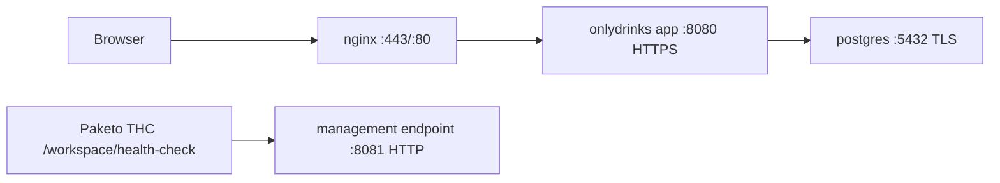
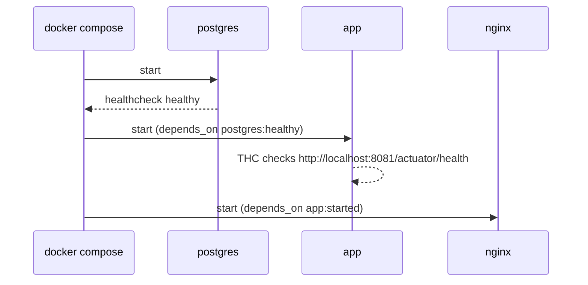

# OnlyDrinks Deployment Guide

## Overview

OnlyDrinks supports two modes:

- Development: Spring profile `dev` with local H2 file database
- Production-like local deployment: Spring profile `prod` with Docker Compose (`app`, `postgres`, `nginx`)

## Runtime Topology



## Startup / Dependency Flow



## Prerequisites

- Java 25 JDK
- Maven 3.9+ (wrapper included)
- Docker + Docker Compose

## Development Mode

Run locally with H2:

```bash
./mvnw spring-boot:run -Dspring-boot.run.profiles=dev
```

Access:

- App: `http://localhost:8080`
- H2 Console: `http://localhost:8080/h2-console`

Default dev users are seeded in `dev` profile only.

## Docker Compose Deployment (Recommended)

1. Copy environment template:

```bash
cp .env.example .env
```

2. Set required values in `.env`:

```dotenv
DB_PASSWORD=your_secure_password
SSL_KEYSTORE_PASSWORD=changeme
```

3. Generate local certificates:

```bash
./scripts/generate-certs.sh
```

4. Build image with buildpacks:

```bash
./mvnw spring-boot:build-image
```

5. Start stack:

```bash
docker compose up -d
```

6. Check status/logs:

```bash
docker compose ps
docker compose logs -f app
```

Access:

- Public app (nginx): `https://localhost`
- PostgreSQL: `localhost:5432`

## Configuration Notes

### Spring Config Layout

- Shared defaults: `src/main/resources/application.yml`
- Dev overrides: `src/main/resources/application-dev.yml`
- Prod overrides: `src/main/resources/application-prod.yml`

### Important Environment Variables

- `SPRING_PROFILES_ACTIVE` (`dev` or `prod`)
- `DB_HOST`, `DB_PORT`, `DB_NAME`, `DB_USERNAME`, `DB_PASSWORD`
- `SSL_KEYSTORE_PATH`, `SSL_KEYSTORE_PASSWORD`
- `MANAGEMENT_SERVER_PORT` (default `8081`)
- `MANAGEMENT_SERVER_SSL_ENABLED` (default `false`)

### Why Management Port 8081 Exists

The app serves user traffic on HTTPS (`8080` inside the container). Paketo THC does not provide HTTPS/basic-auth flags, so the container healthcheck probes an internal HTTP management endpoint on `8081`.

## Database / Migrations

Flyway runs automatically on startup:

- `V1__Initial_Schema.sql`
- `V2__Initial_Data.sql`

## Backup

```bash
# Backup
docker compose exec postgres pg_dump -U onlydrinks onlydrinks > backup.sql

# Restore
docker compose exec -T postgres psql -U onlydrinks onlydrinks < backup.sql
```

## Troubleshooting

- App unhealthy:
  - `docker compose logs -f app`
  - verify THC target: `MANAGEMENT_SERVER_PORT=8081`, `THC_PATH=/actuator/health`
- Postgres startup TLS issues:
  - verify cert files in `certs/`
  - check `scripts/postgres-ssl-entrypoint.sh` is mounted/readable
- Port collisions:
  - adjust `APP_PORT`, `APP_SSL_PORT`, `DB_PORT` in `.env`
