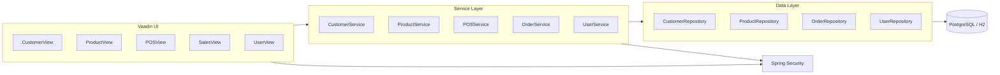
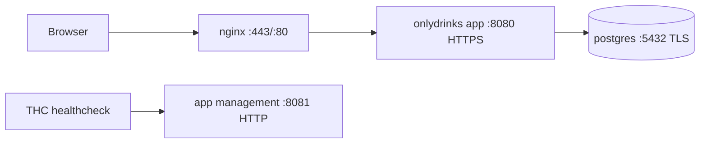
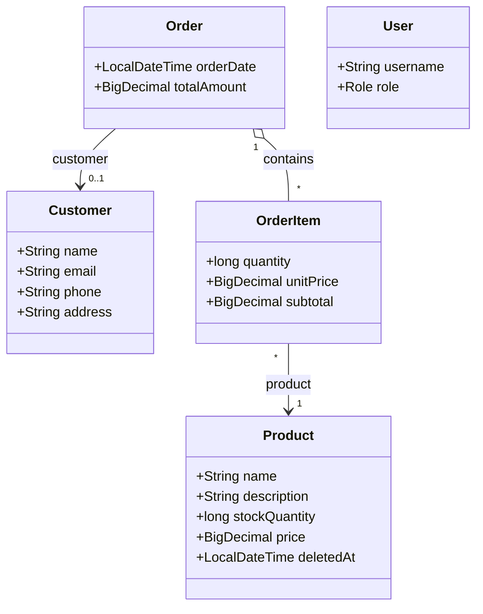

# OnlyDrinks

OnlyDrinks is a portfolio-ready bar management app built with Java, Spring Boot, Vaadin, PostgreSQL, and Docker Compose.

## Stack

- Java 25
- Spring Boot 4
- Vaadin 25
- PostgreSQL 18
- Flyway
- Docker Compose + nginx

## Features

- Customer management
- Inventory management with archive/restore
- Point of sale workflow
- Sales history and analytics
- Role-based access control (`USER`, `BARMAN`, `MANAGER`, `ADMIN`)
- Audit fields on domain entities
- HTTPS in production profile

## Project Structure

- `src/main/java/uy/christian/base` shared UI and base entity infrastructure
- `src/main/java/uy/christian/security` auth, roles, user management
- `src/main/java/uy/christian/customers` customer feature
- `src/main/java/uy/christian/inventory` inventory feature
- `src/main/java/uy/christian/sales` POS and sales feature
- `src/main/resources/db/migration` Flyway migrations
- `docker-compose.yml` production stack (app + postgres + nginx)
- `scripts/generate-certs.sh` local TLS cert generation
- `scripts/postgres-ssl-entrypoint.sh` postgres TLS file permission bootstrap

## Architecture



## Runtime Topology



## Domain Model



## Prerequisites

- Java 25 JDK
- Docker + Docker Compose
- Maven (wrapper included)

## Local Development (dev profile)

1. Start app:

```bash
./mvnw spring-boot:run -Dspring-boot.run.profiles=dev
```

2. Open:

- App: `http://localhost:8080`
- H2 Console: `http://localhost:8080/h2-console`

Default demo users are seeded only in `dev` profile:

- `user` / `user`
- `admin` / `admin`
- `barman` / `barman`

## Docker Deployment (prod profile)

1. Create environment file:

```bash
cp .env.example .env
```

2. Set required values in `.env`:

```dotenv
DB_PASSWORD=your_secure_password
SSL_KEYSTORE_PASSWORD=changeme
```

3. Generate TLS certs:

```bash
./scripts/generate-certs.sh
```

4. Build app image:

```bash
./mvnw spring-boot:build-image
```

5. Start stack:

```bash
docker compose up -d
```

6. Open:

- HTTPS app: `https://localhost`
- Postgres: `localhost:5432`

## Health Checks

- App container healthcheck uses Paketo THC (`/workspace/health-check`)
- THC probes `http://localhost:8081/actuator/health` inside the app container
- Main user traffic stays on HTTPS app port (`8080` in container, proxied by nginx)

## Configuration Notes

- Common settings are in `src/main/resources/application.yml`
- Dev overrides are in `application-dev.yml`
- Prod overrides are in `application-prod.yml`
- Management probe config can be overridden with:
  - `MANAGEMENT_SERVER_PORT`
  - `MANAGEMENT_SERVER_SSL_ENABLED`

## Migrations

Flyway migrations run automatically on startup.

- `V1__Initial_Schema.sql`
- `V2__Initial_Data.sql`

## Repository Hygiene

Local/runtime artifacts are ignored by default:

- `.env`
- `certs/`
- `data/`
- `target/`
- `node_modules/`

## Known Verification Constraint

This project targets Java 25. Running Maven in environments with older JDK toolchains can fail compilation/tests due to unsupported `--release 25`.
