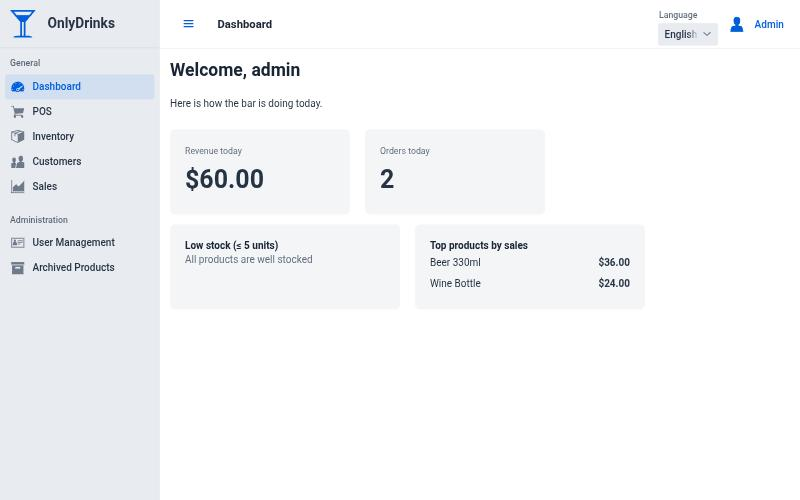
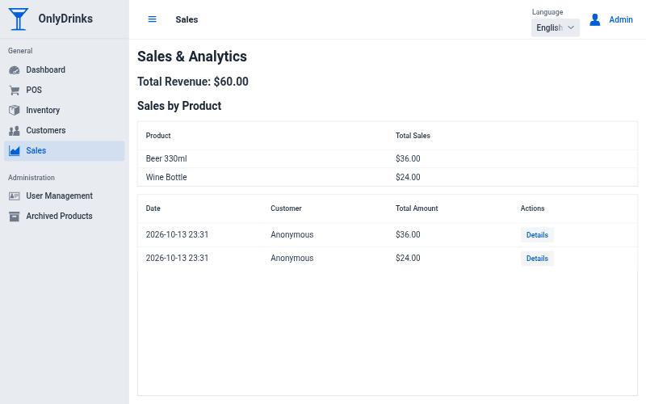
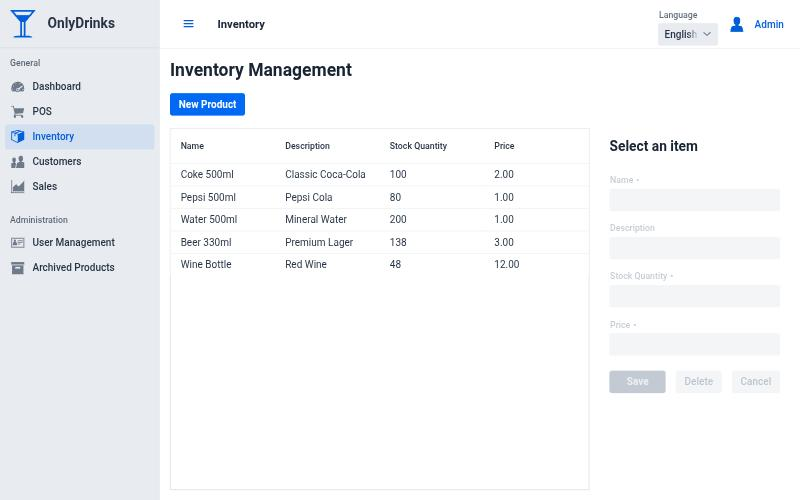
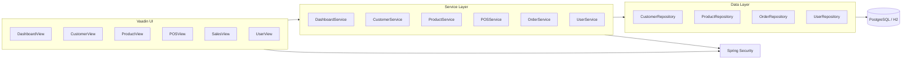
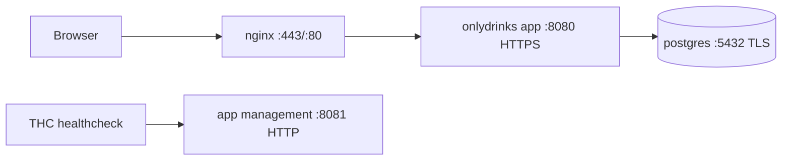
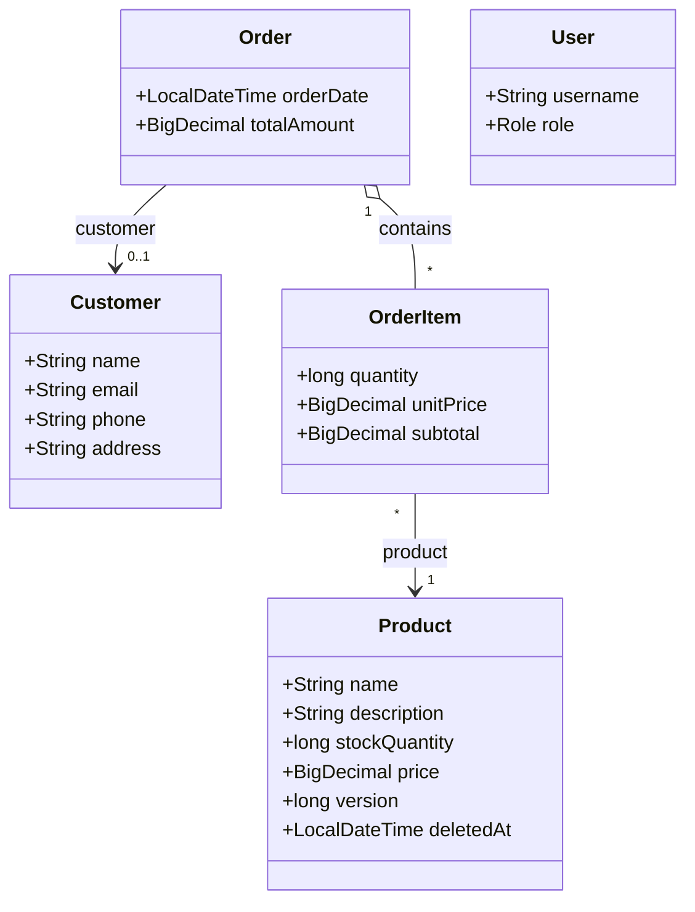

# OnlyDrinks

OnlyDrinks is a bar management app (point of sale, inventory, customers, sales analytics) built with Java, Spring Boot, Vaadin, PostgreSQL, and Docker Compose. It is a portfolio project that tries to get the unglamorous parts right: concurrency, security, migrations, tests, CI, and a hardened deployment.



<details>
<summary>More screenshots</summary>




</details>

## Stack

- Java 25
- Spring Boot 4
- Vaadin 25 (`vaadin-core`: free, Apache 2.0 components only, no commercial license needed)
- PostgreSQL 18 (prod) / H2 (dev)
- Flyway
- Docker Compose + nginx

## Features

- Dashboard with today's revenue and orders, low-stock alerts, and top products (managers and admins)
- Point of sale workflow with stock validation
- Inventory management with archive/restore (soft delete)
- Customer management
- Sales history and per-product analytics (aggregated in SQL)
- Role-based access control (`USER`, `BARMAN`, `MANAGER`, `ADMIN`) with a role hierarchy, enforced at the service layer with `@PreAuthorize`
- English and Spanish UI
- Audit fields (created/updated by and at) on domain entities
- HTTPS everywhere in the production profile (nginx, app, and database TLS)

## Design Decisions

- **No overselling.** `Product` uses optimistic locking (`@Version`), and `OrderService.placeOrder` re-reads and re-validates stock inside the transaction instead of trusting the copy held in the user's session. If two barmen sell the last units at the same time, one of them gets a "stock changed, try again" message rather than negative stock.
- **Soft delete is explicit.** Archiving a product is a normal versioned update (`deletedAt`), not a hidden `@SQLDelete`. There is intentionally no hard delete: products are referenced by sales history.
- **Analytics run in the database.** Sales by product, revenue, and dashboard figures are `GROUP BY` / aggregate queries, not in-memory stream pipelines over every order.
- **Money is `NUMERIC(12,2)`**, with indexes on the columns used for filtering, ordering, and joins (see migrations V3 and V4).
- **Secrets fail fast.** Production config has no default passwords. Docker Compose refuses to start without `DB_PASSWORD` and `SSL_KEYSTORE_PASSWORD`, and `scripts/deploy.sh` rejects weak values such as `changeme`.
- **Testable configuration.** User seeding lives in its own `@Configuration` (`UserBootstrap`), so the main application class has no service dependencies and test slices such as `@DataJpaTest` load cleanly.
- **Free components only.** The project depends on `vaadin-core`, so anyone can clone and build it without a Vaadin Pro subscription.

## Project Structure

- `src/main/java/uy/christian/base` dashboard service, shared UI helpers, and base entity infrastructure
- `src/main/java/uy/christian/security` auth, roles, user management, initial user seeding
- `src/main/java/uy/christian/customers` customer feature
- `src/main/java/uy/christian/inventory` inventory feature
- `src/main/java/uy/christian/sales` POS and sales feature
- `src/main/resources/db/migration` Flyway migrations
- `src/test/java` unit tests and `@DataJpaTest` repository tests (run against the real Flyway schema)
- `docker-compose.yml` production stack (app + postgres + nginx)
- `scripts/deploy.sh` guided deployment workflow (secret generation, validation, certificates); see [DEPLOYMENT.md](DEPLOYMENT.md)
- `scripts/generate-certs.sh` TLS certificate generation
- `scripts/postgres-ssl-entrypoint.sh` postgres TLS file permission bootstrap
- `.github/workflows/ci.yml` build and test on every push and pull request

## Architecture



## Runtime Topology



## Domain Model



## Prerequisites

- Java 25 JDK (for example `sdk install java 25.0.2-tem` with [SDKMAN](https://sdkman.io))
- Docker + Docker Compose (only for the production stack)
- Maven (wrapper included)

## Local Development (dev profile)

1. Start the app:

```bash
./mvnw spring-boot:run -Dspring-boot.run.profiles=dev
```

2. Open:

- App: `http://localhost:8080`
- H2 Console: `http://localhost:8080/h2-console`

Demo users are seeded only in the `dev` profile (never in production):

| Username | Password | Role |
|----------|----------|------|
| `user` | `user` | USER |
| `barman` | `barman` | BARMAN |
| `admin` | `admin` | ADMIN |

The dashboard figures are visible to managers and admins, so log in as `admin` to see them.

## Tests

```bash
./mvnw verify
```

Runs the unit tests and the `@DataJpaTest` suite (Flyway migrations applied to an in-memory H2), then builds the production frontend and packages the jar. The same command runs in GitHub Actions.

## Docker Deployment (prod profile)

The recommended path is the guided script, which generates secrets, validates the environment, and creates the certificates. See [DEPLOYMENT.md](DEPLOYMENT.md) for the full workflow. Manual steps:

1. Create the environment file:

```bash
cp .env.example .env
chmod 600 .env
```

2. Fill in the required values in `.env`. Use strong, unique values: weak defaults such as `changeme` are rejected by the scripts, and Docker Compose will not start without the passwords.

```dotenv
DB_PASSWORD=
SSL_KEYSTORE_PASSWORD=
BOOTSTRAP_ADMIN_PASSWORD=
```

3. Generate TLS certs:

```bash
./scripts/generate-certs.sh
```

4. Build the app image:

```bash
./mvnw spring-boot:build-image
```

5. Start the stack:

```bash
docker compose up -d
```

6. Open:

- HTTPS app: `https://localhost`
- Postgres (loopback only): `127.0.0.1:5432`

## Health Checks

- App container healthcheck uses Paketo THC (`/workspace/health-check`)
- THC probes `http://localhost:8081/actuator/health` inside the app container
- Main user traffic stays on HTTPS app port (`8080` in container, proxied by nginx)

## Configuration Notes

- Common settings are in `src/main/resources/application.yml`
- Dev overrides are in `application-dev.yml`
- Prod overrides are in `application-prod.yml`
- Management probe config can be overridden with:
  - `MANAGEMENT_SERVER_PORT`
  - `MANAGEMENT_SERVER_SSL_ENABLED`

## Migrations

Flyway migrations run automatically on startup.

- `V1__Initial_Schema.sql`
- `V2__Initial_Data.sql` (demo products)
- `V3__Product_Optimistic_Lock.sql`
- `V4__Money_Precision_And_Indexes.sql`

## Repository Hygiene

Local and generated artifacts are ignored by default:

- `.env`
- `certs/`
- `data/`
- `target/`
- `node_modules/`
- `src/main/bundles/` (the production frontend bundle is regenerated on every build)

## License

Released into the public domain. See [LICENSE.md](LICENSE.md).
